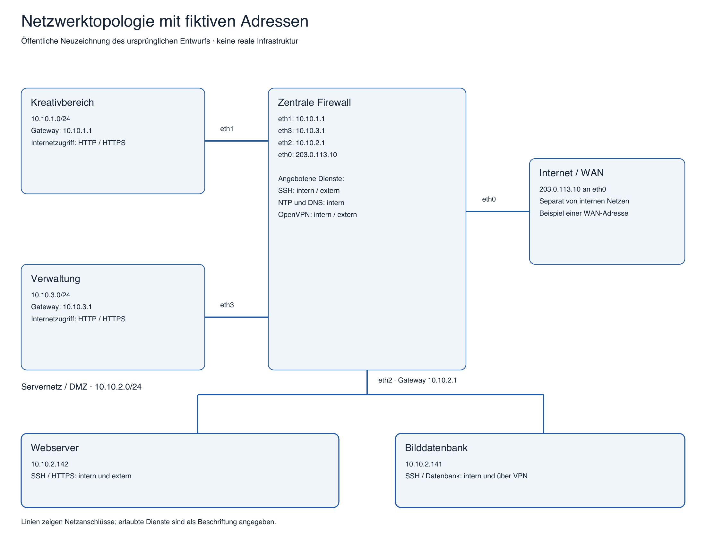

# IT-Sicherheit: Kryptografie, VPN und Firewall

**Praktisches Studienprojekt von Enes Türksever · Sommersemester 2026**

In diesem Projekt habe ich ein Passwortschema untersucht, eine kryptografische Nachricht analysiert, mit OpenPGP und VeraCrypt gearbeitet und eine VPN-/SSH-Verbindung eingerichtet. Anschließend habe ich eine Linux-Firewall mit einem Testplan aus zehn Fällen dokumentiert und eine getrennte Netzwerktopologie geplant.

## Ausführliche Dokumentation

- [Meine ausführliche Dokumentation (PDF)](docs/ITS_Dokumentation.pdf)
- [Dokumentation als Markdown](docs/ITS_Dokumentation.md)

## Was ich praktisch umgesetzt habe

| Bereich | Meine Arbeit |
| --- | --- |
| Passwörter | Hashkonstruktion und Salt untersucht, Kandidaten verglichen und die Grenzen eines festen Passwortkerns bewertet. |
| Kryptografie | XOR-CBC-Verfahren untersucht, Nachrichten mit OpenPGP verschlüsselt und signiert sowie mit einem VeraCrypt-Container gearbeitet. |
| VPN und SSH | OpenVPN-Client konfiguriert und Linux-Zugriffsrechte mit SSH, `ls` und `chmod` untersucht. |
| Firewall | Regeln mit `iptables` erstellt und zehn Testfälle geplant; ausgewählte ursprüngliche Ping-Tests sind durch Screenshots belegt. |
| Netzplanung | Kreativbereich, Verwaltung und Servernetz getrennt und Dienste ihrer Erreichbarkeit zugeordnet. |

## Einblick in die Netzplanung

## Beispiele aus der Umsetzung

- [Firewallskript mit Beispieladressen](src/utpriv_fw.sh.example)
- [OpenVPN-Beispielkonfiguration](src/client.conf.example)

Die Dateien enthalten ausschließlich bereinigte Codebeispiele aus der Dokumentation und sind als `.example` gekennzeichnet und nicht ausführbar abgelegt. Insbesondere das Firewallskript leert bestehende Regeln und setzt restriktive Standardregeln; es darf nicht ungeprüft auf einem eigenen oder entfernten Rechner ausgeführt werden. Es wurde bei dieser Aufbereitung nicht ausgeführt oder gegen die Hochschulsysteme getestet.

## Hinweise zur veröffentlichten Fassung

Dies ist eine redigierte Portfoliofassung meiner Abgabe. Alle Netzadressen wurden durch fiktive Beispieladressen ersetzt oder dauerhaft geschwärzt, auch in den Bildern. Reale Zugangspasswörter, individuelle Chiffrate und Schlüsselwerte, Matrikelnummer, Unterschrift, fremde Benutzernamen und originale Signaturdateien sind nicht enthalten.

Die PDF wird aus dem bereinigten Markdown neu erstellt; Original-PDF, Aufgabenstellung, Professoren-Mail und Abgabearchiv werden nicht mit veröffentlicht. Die technischen Beispiele sind dadurch keine unveränderten Kopien der Prüfungsabgabe. Änderungen und Prüfungen sind in den [Veröffentlichungshinweisen](docs/VEROEFFENTLICHUNG.md) aufgeführt.

Dieses Repository enthält ausschließlich die bereinigte Portfoliofassung. Die ursprünglichen Abgabedateien und ihre Versionshistorie sind nicht Bestandteil dieses Repositorys.

## Autor

Enes Türksever
