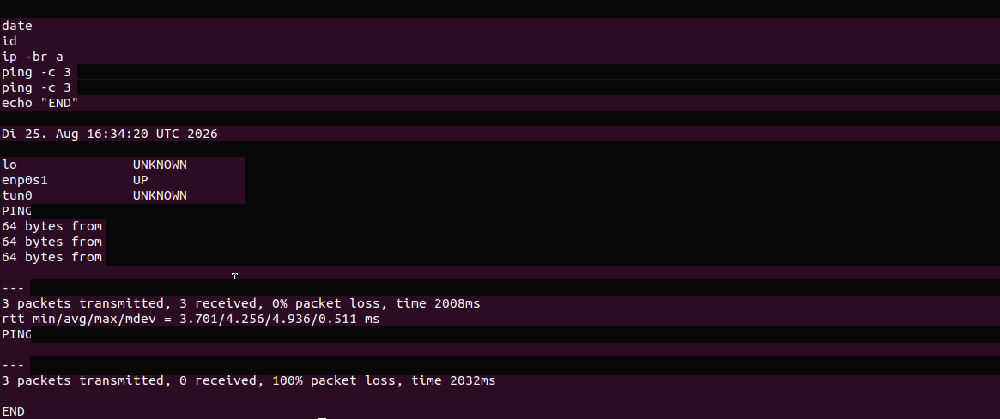
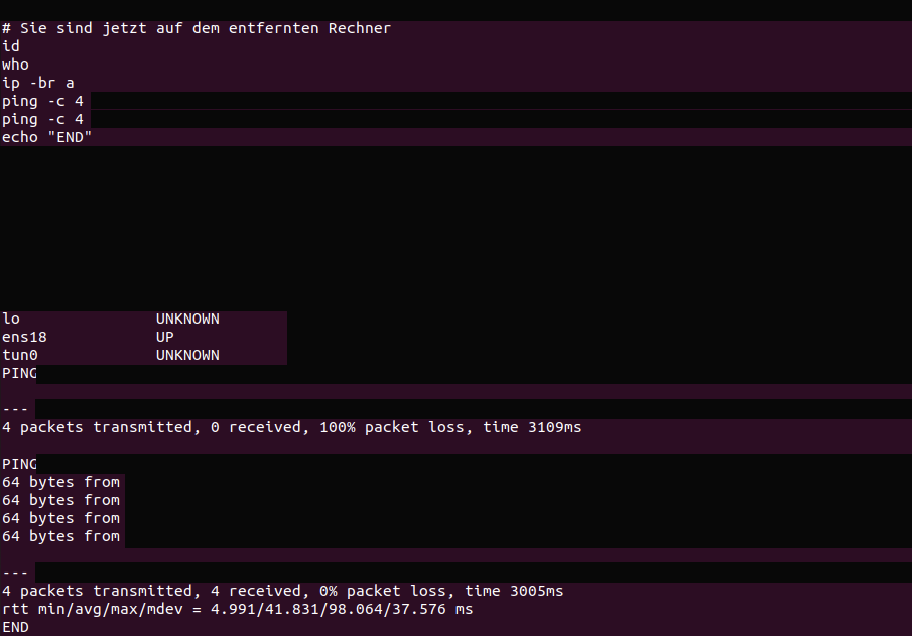
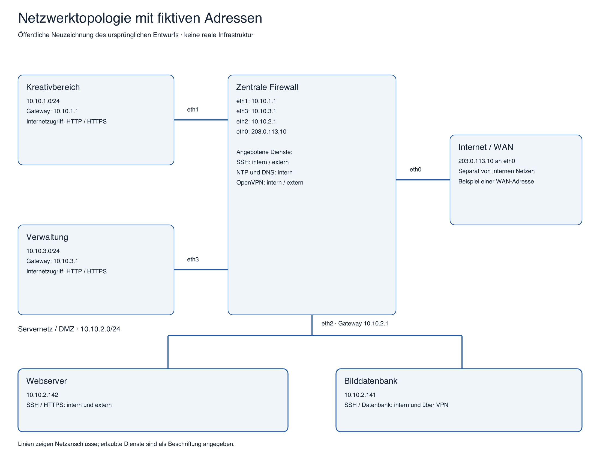

\newpage

# Hinweise zur öffentlichen Fassung {.unnumbered}

Diese Fassung wurde für die Veröffentlichung aus meiner abgegebenen Dokumentation aufbereitet. Sie ist eine redigierte Arbeitsprobe und keine unveränderte Prüfungsabgabe. Die technische Vorgehensweise und die dokumentierten Ergebnisse stammen aus meiner ursprünglichen Arbeit.

**Alle verwendeten Netzadressen sind fiktive Beispielwerte oder dauerhaft geschwärzt.** Die Bereiche `192.0.2.0/24`, `198.51.100.0/24` und `203.0.113.0/24` sowie die frei gewählten internen Netze `10.10.1.0/24`, `10.10.2.0/24` und `10.10.3.0/24` dienen nur der Darstellung. Realer Mailkontakt, reale URLs, Zugangsdaten und rückrechenbare Authentifizierungswerte sind entfernt. Geschwärzte Screenshots enthalten keine verborgenen Originalpixel.

Matrikelnummer, handschriftliche Unterschrift, Originalsignaturen und fremde Benutzerkennungen sind nicht enthalten. Für eine öffentliche Fassung wird keine ursprüngliche Signatur übernommen. Die Quellenangabe zur damaligen KI-Nutzung bleibt erhalten; die Veröffentlichungsfassung wurde zusätzlich mit KI-Unterstützung redigiert.

Die Beispielkonfigurationen sind keine freigegebenen Zugangsdaten und wurden nicht in einem neuen Netzwerk getestet. Das Firewall-Beispiel zeigt den damaligen Prototyp und ist keine allgemeine Sicherheitsempfehlung. Die Befehle sind hier zur Erklärung wiedergegeben.


# Einleitung

## Motivation

Die Sicherheit in der IT wird in nahezu jedem Bereich, in dem die Digitalisierung eine Rolle spielt, von Tag zu Tag relevanter. Daher halte ich die Entscheidung für sinnvoll, im Fach der IT-Sicherheit keine klassische Klausur zu schreiben, sondern eine praktische Projektarbeit zu bearbeiten, die reale Aufgaben und Probleme der IT-Sicherheit widerspiegelt.

Bereits die erste Aufgabe behandelt einen Sicherheitsvorfall, bei dem ein Angreifer Zugriff auf einen Eintrag aus einer Konfigurationsdatei erhalten hat. Da vergleichbare Vorfälle auch in der Realität auftreten können, wird an diesem Beispiel deutlich, welche Folgen unsichere Passwortverfahren haben und wie sich dadurch möglicherweise weitere Passwörter einer Person ableiten lassen.

Auch die Arbeit mit verschlüsselten Daten und VeraCrypt ist praxisnah und vermittelt Kenntnisse, die sowohl im späteren Berufsleben als auch im privaten Umgang mit sensiblen Daten hilfreich sein können.

Das Erstellen und Testen einer eigenen Firewall sowie die abschließende Planung einer sicheren Netzwerkstruktur zeigen außerdem, wie wichtig das Zusammenspiel von IP-Adressen, Ports, Protokollen und getrennten Netzwerkbereichen für die IT-Sicherheit ist.

## Aufgabenstellung

Die Projektarbeit besteht aus vier Teilaufgaben:

1. Die erste Aufgabe behandelt die Untersuchung eines Konfigurationseintrags, der bei einem Sicherheitsvorfall in die Hände eines Angreifers gelangt ist. Dabei sollen das verwendete Hashverfahren und das zugehörige Salt bestimmt und dokumentiert werden. Mithilfe der gewonnenen Informationen sollen anschließend das Klartextpasswort und der vollständige Passwortkern ermittelt werden. Danach wird das erkannte Passwortschema auf eine weitere Domain angewendet und abschließend kritisch bewertet.

2. Die zweite Aufgabe beschäftigt sich mit der praktischen Anwendung verschiedener kryptografischer Verfahren. Zunächst soll eine vorgegebene Geheimnachricht mithilfe des beschriebenen XOR-CBC-Verfahrens entschlüsselt werden. Das Ergebnis wird anschließend als verschlüsselte und digital signierte E-Mail versendet. Mithilfe der erhaltenen Antwort soll ein VeraCrypt-Container geöffnet und aus den darin enthaltenen Dateien eine OpenVPN-Konfiguration erstellt werden. Nach dem Aufbau der VPN- und SSH-Verbindung sollen außerdem verschiedene Zugriffsrechte untersucht und entsprechend den Vorgaben verändert werden.

3. Die dritte Aufgabe befasst sich mit dem Thema Firewall. Dabei wird zunächst vorgegeben, welche Kommunikationsverbindungen erlaubt sein sollen. Auf Grundlage dieser Vorgaben soll ein theoretischer Testplan mit zehn Testfällen und den jeweils erwarteten Ergebnissen erstellt werden. Anschließend soll die Firewall in der Datei utpriv_fw.sh umgesetzt und auf der lokalen Linux-Instanz aktiviert werden. Zum Schluss soll ihre Funktionsweise mithilfe zweier vorgegebener Kommandofolgen überprüft und die jeweiligen Terminalausgaben durch Screenshots dokumentiert werden.

4. Die vierte und letzte Aufgabe thematisiert die Planung eines sicheren Netzwerks für eine Werbeagentur. Auf Grundlage der vorgegebenen Bereiche, Komponenten sowie Server und Clientdienste soll eine geeignete Netzwerktopologie erstellt werden. Dabei müssen die verschiedenen Unternehmensbereiche sinnvoll voneinander getrennt, passende Netz- und IP-Adressen vergeben und die Verbindungen über eine zentrale Firewall dargestellt werden.


# Aufgabe Passwörter

> **Für die Veröffentlichung gekürzt:** Individueller Konfigurationseintrag, Domains, Salt, Hash, Passwortkern und abgeleitete Passwörter werden hier nicht veröffentlicht.

## Untersuchung des gespeicherten Passwortwerts

Im untersuchten Übungsbeispiel verglich ich mit MD5 berechnete Passwortkandidaten mit dem vorgegebenen Hashwert. Die MD5-Ausgabe umfasst 128 Bit und wird als Folge von 32 Hexadezimalzeichen dargestellt. Die Länge allein ist kein eindeutiger Nachweis für ein bestimmtes Hashverfahren.

## Prüfung des Passwortschemas

Das untersuchte Schema leitete einen Teil des Passworts aus einer Domain ab und kombinierte ihn mit einem festen sechsstelligen Zahlenkern. Für eine unbekannte letzte Ziffer wurden zehn Kandidaten geprüft. Außerdem wurden die Kombinationen `Passwort + Salt` und `Salt + Passwort` verglichen. Der passende Hashvergleich wurde in der Abgabe dokumentiert; die individuellen Ein- und Ausgabewerte sind in dieser öffentlichen Fassung entfernt.

## Kritische Bewertung

Ein sechsstelliger Zahlenkern besitzt nur eine Million mögliche Kombinationen. Sind bereits fünf Stellen bekannt, bleiben zehn Kandidaten. Eine öffentlich erkennbare Ableitungsregel erhöht die tatsächliche Sicherheit nur geringfügig. Wird derselbe Kern für mehrere Dienste verwendet, kann ein bekannt gewordenes Passwort Rückschlüsse auf weitere Passwörter zulassen. Die Untersuchung zeigte damit die Grenzen dieses Schemas.

# Aufgabe angewandte Kryptografie

## Entschlüsselung der Geheimnachricht

Ich untersuchte ein vorgegebenes XOR-CBC-Verfahren. Ein bekannter Klartextanfang erlaubte die Bestimmung erster Schlüsselbytes; anschließend wurde die Schlüsselfolge nach dem vorgegebenen Verfahren berechnet. Die entschlüsselte Nachricht wurde anhand einer vorgegebenen Quersumme kontrolliert.

> **Zugangsdaten entfernt:** Die Nachricht enthielt ein später verwendetes Anmeldepasswort. Deshalb sind neben dem Klartext auch Chiffrat, Startblock, Schlüsselwerte, Rechentabellen und Quersummenrechnung entfernt, aus denen dieser Klartext wiedergewonnen werden könnte.

## Verschlüsselte und signierte E-Mail

Die entschlüsselte Nachricht wurde an einen Übungs-Mailbot gesendet. Dazu verschlüsselte ich die Nachricht mit dem öffentlichen Schlüssel des Empfängers und signierte sie mit meinem eigenen privaten Schlüssel. Die Antwort bestätigte Entschlüsselung und Signaturprüfung und enthielt das Passwort für den VeraCrypt-Container.

Die reale E-Mail-Adresse, die Originalnachricht und das Containerpasswort werden nicht veröffentlicht. Als neutrale Beispieladresse steht `uebung@example.invalid` für den Empfänger.

{width=100%}

## OpenVPN-Client-Konfiguration

Die ursprüngliche Konfiguration verwendete TCP, Port `11194` und ein TUN-Interface. Das CA-Zertifikat, das persönliche Client-Zertifikat und der private Schlüssel stammten aus dem eingebundenen VeraCrypt-Container.

**Bereinigtes Dokumentationsbeispiel:** Die Serveradresse und die persönlichen Zertifikats- und Schlüsselpfade sind ersetzt. Der folgende Block entspricht der Datei `src/client.conf.example`. Die aktiven Direktiven der ursprünglichen Konfiguration bleiben ansonsten erhalten; ausführliche Vorlagenkommentare und deaktivierte Optionen wurden weggelassen. Zertifikate und Schlüssel werden nicht mitgeliefert.

```text
# NUR DOKUMENTATIONSBEISPIEL - NICHT VERBINDEN
# Historische Direktiven; Serveradresse und persoenliche Pfade ersetzt.
# Die hier genannten Zertifikate und Schluessel sind nicht enthalten.
client
dev tun
proto tcp
remote 198.51.100.10 11194
resolv-retry infinite
nobind
persist-key
persist-tun
ca pki/ca.crt
cert pki/issued/beispiel-client.crt
key pki/private/beispiel-client.key
remote-cert-tls server
cipher AES-256-CBC
verb 3
```

In der ursprünglichen Umgebung startete ich die Verbindung mit `sudo openvpn --config client.conf`. Die hier gezeigte Fassung dient nur der Dokumentation. Sie wurde nicht erneut verbunden und ist keine aktuelle Konfigurationsempfehlung.

## SSH und Zugriffsrechte

Die Anmeldung auf dem Rechner erfolgte mit `ssh demo-user@198.51.100.20`. Das verwendete Anmeldepasswort wird in dieser Fassung nicht veröffentlicht.

Die Zugriffsrechte des Homeverzeichnisses und der Datei `BEISPIELDATEI` habe ich mit `ls -ld ~` und `ls -l BEISPIELDATEI` ermittelt.

- **Homeverzeichnis:** `drwx------` beziehungsweise **`700`**
- **Datei `BEISPIELDATEI`:** `------x---` beziehungsweise **`010`**

Auf das Homeverzeichnis kann somit ausschließlich der Besitzer zugreifen. Bei der Datei `BEISPIELDATEI` besaß zunächst nur die Gruppe das Ausführungsrecht. Damit ausschließlich der Besitzer lesend auf die Datei zugreifen kann und niemand Schreib- oder Ausführungsrechte besitzt, habe ich den Befehl **`chmod 400 BEISPIELDATEI`** verwendet. Die `4` steht für das Leserecht des Besitzers, während die beiden `0` der Gruppe und allen anderen Benutzern sämtliche Rechte entziehen.

## Inhalt der im Homeverzeichnis abgelegten Datei

Den Inhalt der Datei `BEISPIELDATEI` habe ich mit dem Befehl `cat BEISPIELDATEI` ausgelesen. Die Datei enthält folgendes Zitat:

> “If you think technology can solve your security problems, then you don't understand the problems and you don't understand the technology.” (Bruce Schneier)

Anschließend habe ich mit `id -u` meine User-ID ermittelt. Mit `date > "$(id -u)"` wurde eine Datei mit der ermittelten User-ID als Namen angelegt und die aktuelle Ausgabe des Kommandos `date` darin gespeichert.


# Aufgabe Firewall

In der dritten Aufgabe soll mein lokaler Linux-Rechner durch eine selbst erstellte Firewall abgesichert werden. Ziel der Aufgabenstellung war es, folgende Kommunikationsverbindungen zu erlauben:

- OpenVPN als Client über Port `11194` mit dem Rechner `198.51.100.10`
- ICMP Echo Request und Echo Reply mit `198.51.100.10`
- SSH als Client mit dem Rechner `198.51.100.20`
- eingehende ICMP Echo Requests
- ausgehende ICMP Echo Replies

Andere Verbindungen sollten gesperrt werden. Das folgende Skript dokumentiert meinen damaligen IPv4-Prototyp; seine Grenzen werden unter dem Code erläutert.

## Testplan

**Erwartungen, keine neuen Messergebnisse:** Die zehn Fälle beschreiben den Testplan. Der externe ICMP-Fall wurde für diese öffentliche Fassung auf ein numerisches Beispielziel umgestellt, damit ein DNS-Fehler nicht als Firewall-Ergebnis gilt. Diese redigierten Fälle wurden nicht erneut ausgeführt. Die geschwärzten Screenshots darunter belegen nur die dort sichtbaren ursprünglichen Tests.

Für aussagekräftige Negativtests müssen Route und Ziel zuvor in einem autorisierten Testnetz nachweislich erreichbar sein; bei TCP muss am getesteten Port ein Dienst antworten. Erst ein Vergleich unter sonst gleichen Bedingungen mit aktivem und inaktivem Filter erlaubt eine Zuordnung zur Firewall. Ein Timeout allein beweist keine korrekte Filterregel. Alle Adressen hier sind Darstellungswerte, keine tatsächlich erreichbaren Testziele.

\begingroup
\renewcommand{\arraystretch}{1.25}

### OpenVPN

| Kommando | Beschreibung (Testziel) | Erwartetes Ergebnis |
|---|---|---|
| `sudo openvpn --config client.conf` | Erlaubte OpenVPN-Verbindung testen. | Verbindung erfolgreich. |
| `nc -vz 198.51.100.10 1194` | Nicht freigegebenen TCP-Port testen. | Die Verbindung schlägt fehl (Timeout).|


### ICMP-Verbindungen

| Kommando | Beschreibung (Testziel) | Erwartetes Ergebnis |
|---|---|---|
| `ping -c 4 198.51.100.10` | Ausgehende Echo Requests und eingehende Echo Replies testen. | Ping erfolgreich. |
| `ping -c 4 192.0.2.22` von `198.51.100.10` | Eingehende Echo Requests und ausgehende Echo Replies mit dem freigegebenen Rechner testen. | Ping erfolgreich. |
| `ping -c 4 198.51.100.20` | Ausgehenden Ping zu einem nicht dafür freigegebenen Ziel testen. | Ping schlägt fehl. |
| `ping -c 4 192.0.2.22` von `198.51.100.20` | Eingehenden Echo Request von einem anderen Rechner testen. | Ping erfolgreich. |
| `ping -c 4 203.0.113.200` | Ausgehenden ICMP-Zugriff auf ein nicht freigegebenes, zuvor kontrolliertes Testziel prüfen. | Echo Requests werden gefiltert; keine Echo Replies. |

\newpage

### SSH

| Kommando | Beschreibung (Testziel) | Erwartetes Ergebnis |
|---|---|---|
| `ssh demo-user@198.51.100.20` | Erlaubte SSH-Verbindung testen. | Anmeldung möglich. |
| `ssh user@198.51.100.10` | Nicht erlaubte SSH-Verbindung testen. | Verbindung blockiert. |
| `ssh user@203.0.113.200` | SSH-Verbindung zu einem anderen Ziel testen. | Verbindung blockiert. |

\endgroup

## utpriv_fw.sh

Die Anforderungen an die Firewall wurden im Skript `utpriv_fw.sh` wie folgt umgesetzt:

```bash
#!/bin/bash
# NUR DOKUMENTATIONSBEISPIEL - NICHT UNGEPRUeFT AUSFUeHREN
# Alle Zieladressen sind fiktive Beispieladressen.
# Das Skript leert Firewallregeln und setzt INPUT/OUTPUT/FORWARD auf DROP.
# Uebernommener Projektstand; nur Adressen und Kommentarformat angepasst.


# Vorhandene Regeln und Ketten loeschen
iptables -F
iptables -t nat -F
iptables -t mangle -F
iptables -X
iptables -t nat -X
iptables -t mangle -X


# OpenVPN-Verbindung zu 198.51.100.10 ueber TCP-Port 11194 erlauben
iptables -A INPUT -p tcp -s 198.51.100.10 --sport 11194 -j ACCEPT
iptables -A OUTPUT -p tcp -d 198.51.100.10 --dport 11194 -j ACCEPT


# ICMP Echo Request mit 198.51.100.10
iptables -A OUTPUT -p icmp --icmp-type echo-request -d 198.51.100.10 -j ACCEPT
# ICMP Echo Replies von 198.51.100.10
iptables -A INPUT -p icmp --icmp-type echo-reply -s 198.51.100.10 -j ACCEPT


# SSH-Client-Verbindung mit dem Rechner 198.51.100.20 erlauben
iptables -A OUTPUT -p tcp -d 198.51.100.20 --dport 22 -j ACCEPT
iptables -A INPUT -p tcp -s 198.51.100.20 --sport 22 -j ACCEPT


# Eingehende ICMP Echo Requests erlauben
iptables -A INPUT -p icmp --icmp-type echo-request -j ACCEPT
# Ausgehende ICMP Echo Replies erlauben
iptables -A OUTPUT -p icmp --icmp-type echo-reply -j ACCEPT


# Alle uebrigen Kommunikationsverbindungen blockieren
iptables -P INPUT DROP
iptables -P OUTPUT DROP
iptables -P FORWARD DROP
```

In der ursprünglichen Umgebung aktivierte ich das Skript mit `sudo bash utpriv_fw.sh`. Bei dieser Aufbereitung wurde es nicht ausgeführt.

**Einordnung des ursprünglichen Prototyps:** Das Skript bearbeitet IPv4-Regeln, nicht die IPv6-Firewall. Die TCP-Freigaben prüfen Adresse und Port, jedoch keinen Verbindungszustand. Eigene Freigaben für Loopback und DNS fehlen. Das Leeren der Tabellen entfernt bestehende Regeln; bei einem Fehler oder auf einem entfernten System kann der Zugriff abbrechen. Die Befehlslogik wurde für die Veröffentlichung nicht nachträglich verbessert. Die Syntaxprüfung ersetzt keinen Funktionstest.


## Screenshots

### Test der Firewall mit meinem Gerät

Die folgende Kommandofolge wurde auf meinem lokalen Linux-Rechner verwendet. Die im Text angegebenen Adressen und die Kennung sind neutrale Ersatzwerte; die entsprechenden Stellen im Originalbild sind geschwärzt.

```text
echo "DONE BY demo-user"
date
id
ip -br a
ping -c 3 198.51.100.10
ping -c 3 198.51.100.20
echo "END"
```

Dabei wird erwartet, dass der Ping an **198.51.100.10** erfolgreich ist, da die ICMP-Kommunikation mit diesem Rechner durch die Firewall erlaubt wird. Der Ping an **198.51.100.20** sollte dagegen mit 100 % Paketverlust fehlschlagen, weil zu diesem Rechner ausschließlich eine SSH-Verbindung erlaubt ist.

{width=100%}

### Test der Firewall über SSH

Der folgende ursprüngliche Test erfolgte über eine SSH-Sitzung auf dem entfernten Rechner. Der Befehl **`ssh demo-user@198.51.100.20`** zeigt die bereinigten Ersatzwerte, nicht die damaligen Verbindungsdaten. Das Anmeldepasswort ist in dieser Fassung entfernt.

Anschließend führte ich die vorgegebenen Kommandos aus. Für meine damalige VPN-IP-Adresse steht hier der fiktive Ersatzwert `192.0.2.22`. Die persönlichen Marker und Adressen sind im Originalbild geschwärzt.

```text
echo "START REMOTE CHECK (demo-user)"
# Sie sind jetzt auf dem entfernten Rechner
id
who
ip -br a
ping -c 4 198.51.100.10
ping -c 4 192.0.2.22
echo "END"
```

Das ursprüngliche Bild zeigt **100 % Paketverlust** beim Ping vom entfernten Rechner zum VPN-Endpunkt und einen erfolgreichen Ping zum lokalen VPN-Client. Der erste Befund ist eine Beobachtung des entfernten Netzwerkpfads und kein Nachweis für eine Regel meiner lokalen Firewall. Der erfolgreiche Ping zum lokalen Client ist mit der Freigabe eingehender Echo Requests und ausgehender Echo Replies vereinbar. Die Ursache des ersten Paketverlusts wurde bei dieser Aufbereitung nicht erneut untersucht.

{width=100%}


# Aufgabe Sichere Netzplanung

## Netzwerktopologie

Die folgende Abbildung zeigt eine Neuzeichnung meiner geplanten Netzwerktopologie. Netzaufteilung und angebotene Serverdienste sind aus dem ursprünglichen Entwurf übernommen; sämtliche Adressen sind fiktive Beispielwerte. Die Beispielnetze in diesem Kapitel sind unabhängig vom vorherigen VPN-/Firewall-Versuch zu lesen.

{width=100%}

Das interne Netzwerk wurde in die drei voneinander getrennten Bereiche **Kreativbereich**, **Servernetz (DMZ)** und **Verwaltung** aufgeteilt. Jeder Bereich ist über eine eigene Schnittstelle mit der zentralen Firewall verbunden. Dadurch wird die Kommunikation zwischen den Netzen und mit dem Internet über die Firewall kontrolliert.

In dieser öffentlichen Darstellung steht `10.10.1.0/24` für den Kreativbereich, `10.10.2.0/24` für das Servernetz und `10.10.3.0/24` für die Verwaltung. Die jeweiligen Firewall-Schnittstellen verwenden die Hostadresse `.1`. Die externe Schnittstelle `eth0` besitzt die fiktive WAN-Beispieladresse `203.0.113.10`.

Der Webserver mit der IP-Adresse `10.10.2.142` und die Bilddatenbank mit der IP-Adresse `10.10.2.141` befinden sich im getrennten Servernetz. Die von den einzelnen Servern angebotenen Dienste und ihre jeweilige Erreichbarkeit sind ebenfalls in der Abbildung dargestellt.

# Zusammenfassung

Während der Bearbeitung der Projektarbeit wurden verschiedene Themen der IT-Sicherheit praktisch behandelt. Die vier Hauptaufgaben beschäftigten sich mit Passwörtern, angewandter Kryptografie, einer Firewall und der sicheren Netzplanung.

**Aufgabe 1**

In der ersten Aufgabe wurde ein Konfigurationseintrag aus einem Sicherheitsvorfall untersucht. Dabei konnte ich das verwendete Hashverfahren und das Salt bestimmen. Anschließend habe ich durch das vorgegebene Passwortschema und den Vergleich der berechneten Hashwerte das Klartextpasswort sowie den vollständigen Passwortkern ermitteln können.

Das vorher erkannte Schema wurde danach auf eine weitere Domain angewendet. Bei der abschließenden Bewertung zeigte sich, dass die daraus gebildeten Passwörter zwar unterschiedlich aussehen, jedoch von einem gleichbleibenden Zahlenkern und einer leicht erkennbaren Regel abhängen. Sobald das Schema bekannt ist, können deshalb auch weitere Passwörter abgeleitet werden.


**Aufgabe 2**

In der zweiten Aufgabe stand die praktische Anwendung kryptografischer Verfahren im Mittelpunkt. Zunächst habe ich eine mit einem veränderten XOR-CBC-Verfahren verschlüsselte Nachricht entschlüsselt. Durch den bekannten Anfang des Klartextes konnten die ersten Schlüsselwerte bestimmt und die restliche Schlüsselfolge berechnet werden.

Die entschlüsselte Nachricht habe ich anschließend mit OpenPGP verschlüsselt und digital signiert per E-Mail an den Übungs-Mailbot versendet. Aus der Antwort erhielt ich das Passwort für einen VeraCrypt-Container, der meine persönlichen OpenVPN-Zugangsdaten enthielt. Mithilfe dieser Daten wurde eine eigene OpenVPN-Konfiguration erstellt und eine Verbindung zum vorgesehenen Netzwerk aufgebaut.

Danach habe ich mich per SSH auf dem entfernten Rechner angemeldet. Dort wurden die Zugriffsrechte des Homeverzeichnisses und einer Datei untersucht und entsprechend den Vorgaben angepasst. Abschließend wurde der Inhalt der Datei ausgelesen und eine weitere Datei mit meiner User-ID als Namen angelegt.

**Aufgabe 3**

In der dritten Aufgabe wurde eine Firewall für meine lokale Linux-Instanz erstellt. Vor der Umsetzung habe ich einen theoretischen Testplan mit erlaubten und nicht erlaubten Kommunikationsverbindungen angefertigt. Dadurch ließ sich bereits im Voraus festlegen, welches Verhalten bei den späteren Tests erwartet wurde.

Die Firewallregeln wurden anschließend mit `iptables` in einem Shell-Skript umgesetzt. Die Regeln sollten die geforderten OpenVPN-, ICMP- und SSH-Verbindungen erlauben und andere IPv4-Verbindungen sperren. Nach der Aktivierung wurden ausgewählte Pings lokal und über eine SSH-Sitzung dokumentiert. Die vorhandenen Bilder belegen nicht sämtliche zehn Fälle des Testplans und keine vollständige Absicherung von IPv4 und IPv6. Die Grenzen des ursprünglichen Skripts sind im Firewall-Kapitel erläutert.

**Aufgabe 4**

In der letzten Aufgabe wurde eine sichere Netzwerktopologie für eine Werbeagentur geplant. Die einzelnen Unternehmensbereiche wurden voneinander getrennt und jeweils einem eigenen Netz zugeordnet. Zusätzlich wurden passende Netz- und IP-Adressen vergeben und die Bereiche über verschiedene Schnittstellen mit einer zentralen Firewall verbunden.

Der Webserver und die Bilddatenbank wurden in einem getrennten Servernetz eingeordnet. Außerdem wurden die angebotenen Dienste und deren interne, externe oder über VPN mögliche Erreichbarkeit in der Netzwerktopologie dargestellt. Dadurch wird die Kommunikation zwischen den einzelnen Bereichen kontrolliert und der direkte Zugriff auf interne Systeme eingeschränkt.

**Fazit**

Die Projektarbeit hat mir einen praxisnahen Einblick in verschiedene Bereiche der IT-Sicherheit gegeben. Durch die Bearbeitung konnte ich die Inhalte aus der Vorlesung und den Übungen praktisch anwenden und die Zusammenhänge zwischen Passwörtern, Verschlüsselung, Zugriffsrechten, Firewallregeln und Netzplanung besser nachvollziehen.


# Quellen- und Literaturverzeichnis

- OpenAI. (2026). ChatGPT. Abgerufen am 30. August 2026 von [URL in der öffentlichen Fassung entfernt]

- Quade, J. (2026). Vorlesungs- und Übungsmaterialien IT-Sicherheit. Abgerufen am 18. August 2026 von [URL in der öffentlichen Fassung entfernt]

- Cone, M. (2026). Markdown Guide – Basic Syntax. Abgerufen am 18. August 2026 von [URL in der öffentlichen Fassung entfernt]

- OpenVPN. (2026). OpenVPN 2.6 Manual. Abgerufen am 24. August 2026 von [URL in der öffentlichen Fassung entfernt]

- Bundesamt für Sicherheit in der Informationstechnik. (2023). NET.1.1 Netzarchitektur und -design. Abgerufen am 28. August 2026 von [URL in der öffentlichen Fassung entfernt]